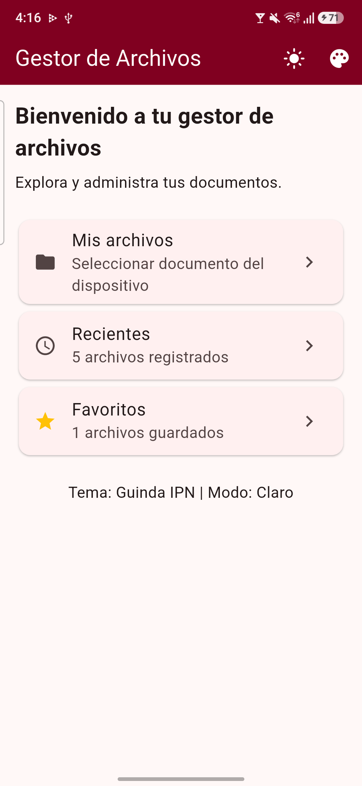
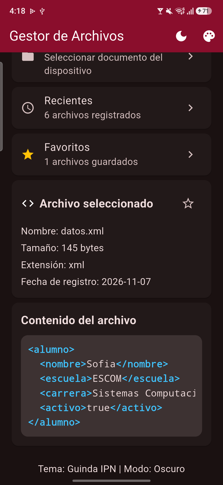
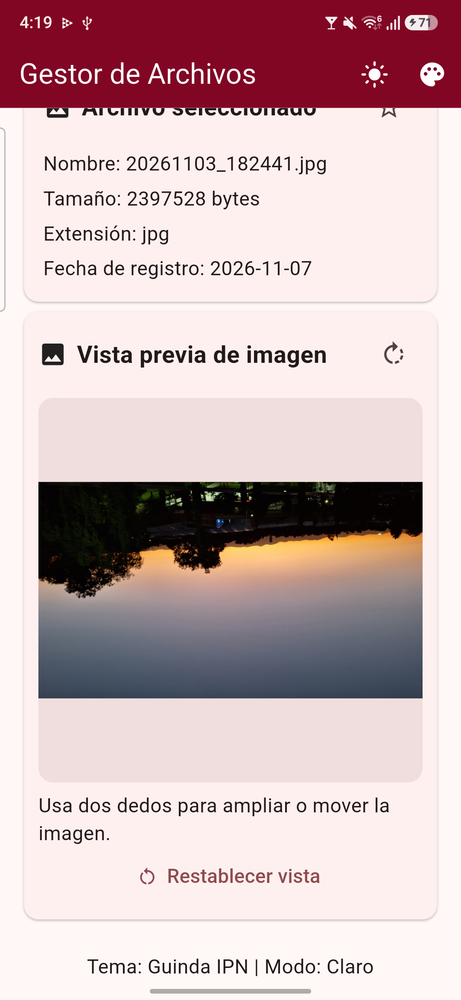
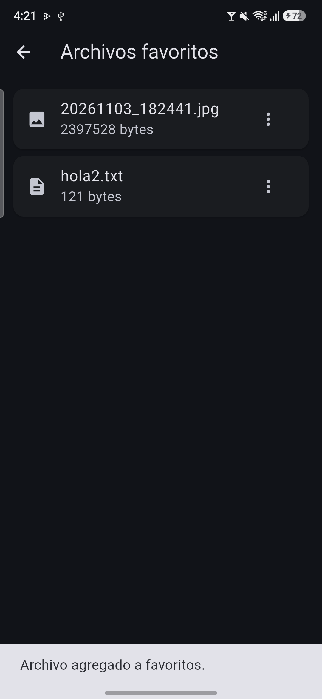
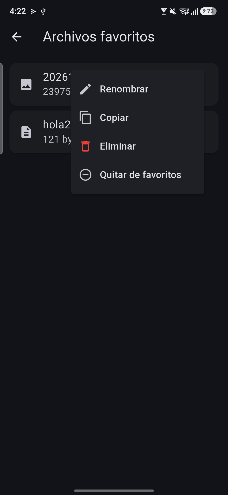

# 📁 Gestor de Archivos Multiplataforma

**Práctica 4 — Gestión de archivos multiplataforma**

Aplicación desarrollada con Flutter y Dart para seleccionar, visualizar y administrar archivos desde un dispositivo móvil.

## Funcionalidades implementadas

- Selección de archivos desde el dispositivo.
- Visualización de TXT, Markdown, JSON, XML e imágenes.
- Zoom y rotación de imágenes.
- Temas IPN y ESCOM, con modo claro y oscuro.
- Historial de archivos recientes y favoritos.
- Operaciones para renombrar, copiar y eliminar archivos.

## Tecnologías

- Flutter y Dart
- file_picker
- path_provider
- shared_preferences
- xml

## Evidencias de funcionamiento

### Pantalla principal

### Selección y visualización de archivos

### Visualización de imágenes

### Temas de la aplicación

### Archivos recientes y favoritos

### Administración de archivos

## Estado del proyecto

**Parte 1:** Gestor de archivos implementado y probado en Android.

**Parte 2:** Videojuego pendiente de desarrollo.

**Nota:** La ejecución en iOS no se ha verificado.
